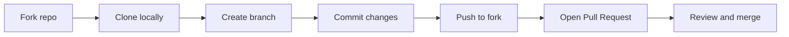

  

 

  

  

[About](#-about-me) • [Tech Stack](#%EF%B8%8F-tech-stack) • [Open Source](#-open-source-journey) • [Roadmap](#-roadmap) • [Stats](#-github-stats) • [Connect](#-connect-with-me)

## 👩‍💻 About me

- 🎓 B.Tech in Information Technology (2026), Sri Venkateswara College of Engineering
- 💼 Former project intern at **Virtusa**, where I built a Java-based stack project
- 🌱 Learning Docker, Jenkins, Linux and cloud
- 🤝 Always happy to collaborate on open source

## 🛠️ Tech stack

 

## 🌍 Open source journey

| Repo | What it is |
|------|------------|
| [Welcome-to-Open-Source](https://github.com/SowndaryaS0201/Welcome-to-Open-Source) | Where I practised my first pull requests and learned the contribution workflow |
| [openclaw](https://github.com/SowndaryaS0201/openclaw) | Forked to explore and learn from an open source AI agent project |

### How I contribute

## 🗺️ Roadmap

- [x] Learn the Git and GitHub workflow
- [x] Practise first pull requests
- [ ] Build a CI/CD pipeline with Jenkins
- [ ] Containerise a Java app with Docker
- [ ] Automate a workflow with GitHub Actions
- [ ] Make my first merged contribution to a real project

## 📊 GitHub stats

## 🐍 Contribution snake

<picture>
  <source media="(prefers-color-scheme: dark)" srcset="https://raw.githubusercontent.com/SowndaryaS0201/SowndaryaS0201/output/github-contribution-grid-snake-dark.svg">
  
</picture>

## 📫 Connect with me

 

 *Thanks for stopping by!* 

